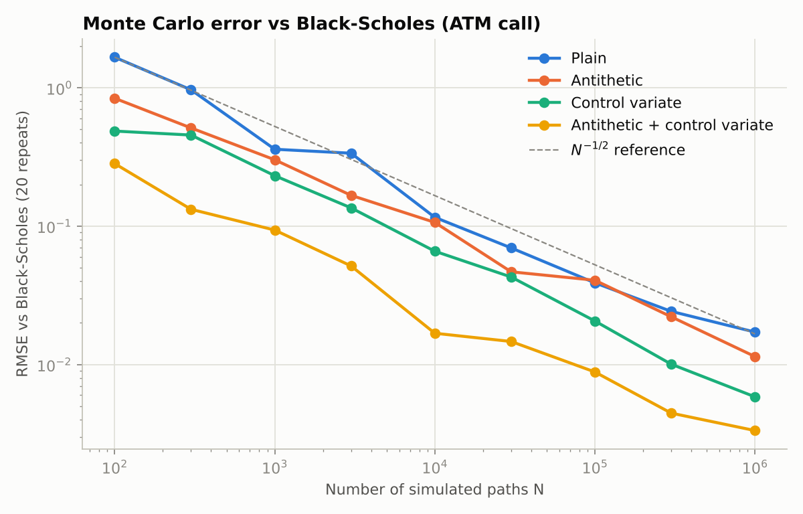
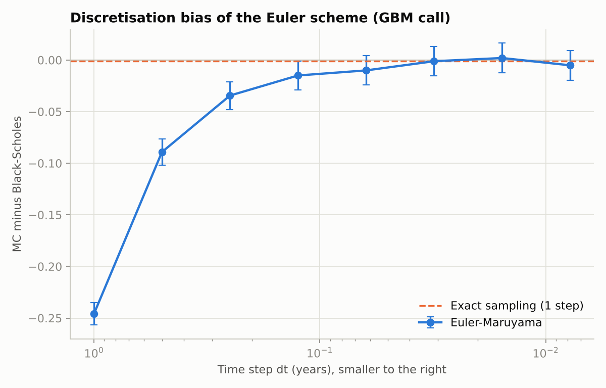
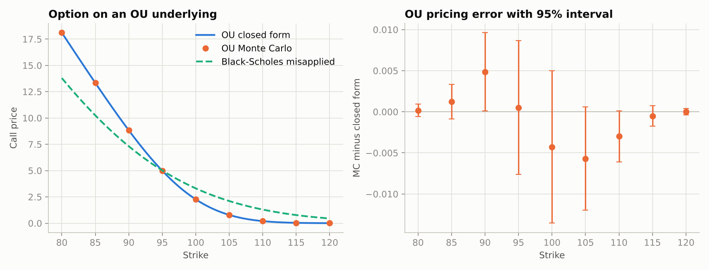

# Stochastic Process Simulator & Derivative Pricing Engine

Monte Carlo option pricing under two stochastic models, benchmarked against closed-form prices.

- **Geometric Brownian Motion (GBM)**: equity-style underlying, benchmarked against **Black-Scholes**.
- **Ornstein-Uhlenbeck (OU)**: mean-reverting underlying (spreads, rates, commodities), benchmarked against its own **Gaussian closed form**.

Black-Scholes assumes lognormal dynamics, so it is only a valid benchmark for GBM. An OU process is Gaussian and can go negative, so its terminal distribution is `N(m, v)` and a European option reduces to a Bachelier-type formula (`pricing_engine/ou_analytics.py`). Experiment 5 shows what goes wrong if you misapply Black-Scholes to OU.

## Quick start

```bash
pip install -r requirements.txt
python -m pytest -q          # 19 tests
python run_experiments.py    # ~10 s, writes figures + results/summary.md
```

## Layout

```
pricing_engine/
  processes.py       GBM and OU: exact and Euler-Maruyama stepping, path and terminal simulators
  monte_carlo.py     European pricer: antithetic variates, control variate, honest standard errors
  black_scholes.py   Black-Scholes price and delta/gamma/vega
  ou_analytics.py    Closed-form European option on an OU underlying
run_experiments.py   Five experiments -> results/*.png, summary.md, results.json
tests/               Parity, convergence, variance-reduction and moment checks
```

## Method

**Processes** (risk-neutral drift for GBM, `mu = r`)

| Model | SDE | Exact step |
|---|---|---|
| GBM | `dS = r S dt + sigma S dW` | `S exp((r - sigma^2/2) dt + sigma sqrt(dt) Z)` |
| OU | `dX = kappa (theta - X) dt + sigma dW` | `theta + (X - theta) e^(-kappa dt) + sigma sqrt((1 - e^(-2 kappa dt)) / (2 kappa)) Z` |

**Variance reduction**

- *Antithetic variates*: every shock stream `Z` is paired with `-Z` and the two payoffs are averaged.
- *Control variate*: regress the discounted payoff on the discounted terminal value, whose mean is known exactly (`S0` for GBM, `m` for OU).
- Standard errors are computed on independent units (pair means when antithetic), so the confidence intervals are valid.

## Results

GBM: S0 = 100, K = 100, r = 5%, sigma = 20%, T = 1. Black-Scholes call = **10.4506**. Full tables in `results/summary.md`.

**1. Variance reduction at N = 100,000 paths**

| Method | Std error | Variance reduction |
|---|---|---|
| Plain | 0.0466 | 1.0x |
| Antithetic | 0.0329 | 2.0x |
| Control variate | 0.0178 | 6.9x |
| Antithetic + control variate | 0.0087 | 28.6x |



Plain Monte Carlo error falls as `N^(-1/2)`; the variance-reduced estimators sit on parallel lines below it.

**2. Strike sweep (K = 70 to 130).** Monte Carlo matched Black-Scholes at every strike, with all 13 of 13 95% intervals covering the true value.

**3. Euler-Maruyama discretisation bias.** With 1 step the Euler scheme underprices the ATM call by 0.246 (about 2.4%). The bias shrinks with `dt` and is inside Monte Carlo noise (standard error about 0.007) from roughly 32 steps. Exact sampling needs one step and shows no bias.



**4. OU options.** Monte Carlo agrees with the OU closed form at all strikes; 8 of 9 95% intervals cover the exact value, which is consistent with the expected miss rate for 95% intervals (the one miss, K = 90, is about 2 standard errors).

**5. Misapplying Black-Scholes to OU.** Using Black-Scholes with `sigma / x0` as the volatility mis-prices the option materially: 3.31 vs the correct 2.27 at K = 100 (about 46% too high), and 0.45 vs 0.004 at K = 120. Mean reversion shrinks terminal dispersion relative to GBM, which Black-Scholes cannot capture.



## Notes and limitations

- OU is treated as pricing-measure dynamics with constant-rate discounting. That is a modelling choice for spread/rate/commodity underlyings, not a derivation from no-arbitrage for a traded asset.
- Only European payoffs are implemented. `simulate_paths` returns full paths, so path-dependent payoffs (Asian, barrier) are a natural extension.
- Every experiment uses fixed seeds, so results reproduce exactly.
